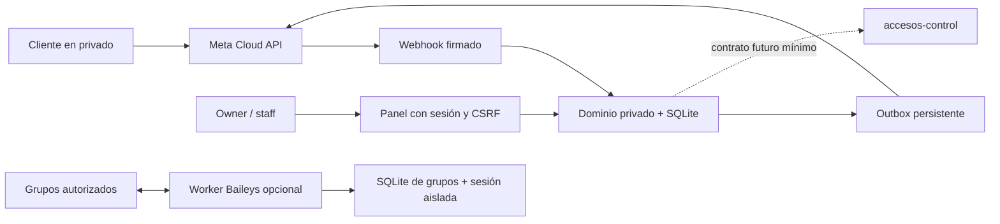

# Click&Cut Bot 2.0 — diseño e implementación local

Estado: implementación candidata para revisión. No publicada, desplegada ni vinculada a WhatsApp. Origen: `agentem999mx-ops/Clickcut-ssoporte-bot`, commit `3089d4af50d236d9eeee7ae2edc934b28471cad3`. Las referencias comerciales, horarios, reglas, productos y precios deben ser confirmados por el negocio; no se copiaron como hechos las promesas de garantía del bot anterior.

## Separación de canales

El canal privado usa exclusivamente WhatsApp Business Platform Cloud API oficial. Baileys solo escucha los grupos explícitos de su lista. No se usa como respaldo del canal privado ni para eludir una restricción de Meta. Un fallo de Baileys no detiene el servicio privado. Preferir números distintos para contener el impacto de una restricción; esta separación no garantiza que Meta no relacione cuentas.

## Módulos y flujos implementados

* `src/server.js`: HTTP, webhook GET de verificación, POST firmado sobre bytes originales, panel y operaciones administrativas. Filtra `phone_number_id`, procesa todas las entradas del lote y estados de entrega. No registra cuerpos ni tokens en consola.
* `src/domain.js`: catálogo, pedido con precio congelado, renovación vinculada a pedido propio completado, ticket con folio UUID, consulta de estado limitada al cliente, baja/alta y escalamiento humano. No hay cobro, confirmación de transferencia ni entrega automática de accesos. Un pedido es una solicitud pendiente hasta revisión humana.
* `src/cloud.js`: cliente Graph versionado y outbox. Un HTTP exitoso solo indica aceptación, no entrega. Guarda identificador de Meta y actualiza entrega por webhook. Reintenta únicamente 429 con espera exponencial y tope de intentos. Timeout, 5xx o interrupción después del envío quedan `unknown` para conciliación manual. No existe garantía de entrega exactamente una vez entre SQLite y Meta.
* `src/security.js`: scrypt con sal aleatoria, sesiones opacas de 8 horas con hash persistido, cookie HttpOnly/SameSite, CSRF y auditoría mínima. La cookie exige Secure en producción. Contraseñas de 14–256 caracteres. Alta/reset/desactivación de usuarios por herramienta local; no hay registro público ni contraseña inicial.
* `groups/`: proceso opcional, permisos propios, reglas, avisos, abrir/cerrar y agenda puntual persistente UTC. Sus dependencias no forman parte del servicio oficial.
* `src/access-control.js`: puerto deshabilitado y validadores que construyen una respuesta solo con campos permitidos. No se conecta ni modifica `accesos-control`.

Cliente: `CATALOGO`, `PEDIR id`, `RENOVAR folio`, `TICKET servicio y problema`, `ESTADO folio`, `HUMANO`, `BAJA`, `ALTA`. Se aceptan textos e identificadores de respuestas interactivas. El catálogo es textual; no configura un Commerce Catalog de Meta. No se descargan archivos, comprobantes ni audios. Esos mensajes reciben orientación de menú, salvo que la conversación esté en atención humana.

`HUMANO` abre un ticket, marca el cliente en atención humana y bloquea respuestas anteriores pendientes. Después solo responde el personal autorizado. La aceptación de un envío que ya estaba en curso no se puede revertir. El owner asigna el caso desde el panel. El equipo puede reanudar el bot explícitamente. `ALTA` recupera consentimiento de mensajes, pero no desactiva el modo humano. No hay promesa automática de tiempo de respuesta.

## Datos y consistencia

SQLite con claves foráneas, WAL, transacciones e índices; disco persistente, una instancia del servicio oficial y una del worker. No usar un filesystem compartido entre múltiples réplicas. Node 24.22 utiliza `node:sqlite` como API todavía experimental; está verificado localmente con esa versión. Para mayor volumen: migrar el repositorio de datos a PostgreSQL, cola externa con leases, migraciones versionadas y workers separados antes de escalar. No basta con subir el número de instancias.

| Tabla | Contenido y propósito |
| --- | --- |
| users / sessions | Roles, hashes de contraseña, sesiones revocables y CSRF |
| customers | UUID interno, ID WhatsApp, último mensaje original, baja y modo humano |
| products | Catálogo activo, precio en centavos y moneda MXN |
| orders | Cliente, producto, precio congelado, compra/renovación, referencia anterior, estado y responsable |
| tickets | Cliente, descripción limitada, prioridad normal/urgent, estado y responsable |
| inbox | Solo ID del evento y fecha: evita repetir operaciones por reentrega |
| outbox | Respuesta pendiente, intentos, estado, ID de proveedor y entrega |
| audit | Actor, operación, objetivo y fecha; sin contraseña ni copia del mensaje |
| groups.seen / jobs / audit | Deduplicación de grupo, agenda y auditoría separadas |

Se guardan textos entrantes limitados a 2000 caracteres, descripciones de tickets y respuestas en cola; son datos personales potenciales. La tabla messages vincula cada texto al cliente y a su fecha. El panel muestra hasta 100 filas por sección, sin paginación. La conversación permite leer los últimos 50 textos entrantes y 50 salientes del cliente autorizado, incluidos los recibidos durante atención humana. Cada consulta genera auditoría. No se descargan adjuntos ni se importa el historial previo de WhatsApp.

Las migraciones iniciales son idempotentes (`user_version=1`); una evolución futura debe ejecutar migraciones secuenciales y copia previa. Los IDs de entrada se retienen para deduplicación. No hay importación de tickets anteriores: el código original no los persistía. Se corrigió el archivo `package.json` cuyo nombre terminaba en U+2060 y se retiró el punto de entrada antiguo para evitar arrancarlo accidentalmente.

## Permisos

| Acción | owner | staff |
| --- | --- | --- |
| Ver casos | Todos | Solo asignados a su usuario |
| Cambiar estado de caso | Todos | Solo asignados |
| Asignar responsables | Sí | No |
| Editar catálogo | Sí | No |
| Ver clientes / pausar bot / responder | Todos | Cliente con al menos un caso asignado |
| Ver teléfonos completos | No en panel | No en panel |
| Revisar estados de envíos | Sí | No |
| Crear/desactivar usuarios | Operador local con acceso al servidor | No desde panel |
| Comandos Baileys | Lista local + admin WA actual | Lista local + admin WA actual |

Los roles del panel no se infieren por número de teléfono ni por ser administrador de un grupo. Ningún parámetro enviado por el navegador decide el rol. Se comprueba el permiso en cada operación. Desactivar usuario o cambiar su contraseña revoca sesiones; no se permite desactivar al último owner activo. El acceso local al servidor es una capacidad privilegiada.

## Seguridad y operación

Secretos en gestor del proveedor o archivos de entorno con permisos restringidos, nunca en Git, imágenes, parches, capturas ni logs. Rotar tokens al cambiar personal o ante incidente; revocar sesiones administrativas y dispositivos vinculados de Baileys por separado. QR, archivos de sesión de Baileys y copias de SQLite son sensibles. Las carpetas se crean privadas donde el sistema lo permite; en Windows aplicar ACL del usuario de servicio. Las claves de cifrado de backups deben guardarse fuera del disco de datos.

El worker de grupos rechaza arrancar si recibe `META_ACCESS_TOKEN` o `META_APP_SECRET`. Desplegarlo con usuario del sistema, volumen y entorno propios, sin acceso a la base privada. La API no importa las librerías de grupos. No montar todo el disco de datos en ambos servicios. Configurar firewall, HTTPS y límites de tráfico en el proxy; la limitación de login y peticiones administrativas del código es por IP de conexión, no confía en `X-Forwarded-For`. Tras un proxy todas las conexiones comparten el límite: aplicar rate limit por IP real en el proxy y adaptar límites internos antes de abrir a muchos operadores.

SQL parametrizado; tablas dinámicas limitadas a lista fija. Renderizado del panel con `textContent`, CSP sin scripts inline, límite de tamaño de cuerpo y tiempo de conexión. No almacenar tarjetas, contraseñas de plataformas ni PIN. El texto libre puede contener datos que el cliente decida enviar: informar, restringir acceso y depurar durante soporte; el código no puede garantizar que no los escriba. Prioridad existe en el esquema con valor normal; el panel actual modifica estado y responsable, sin editor de prioridad.

Propuesta de retención a validar con el negocio: tickets cerrados y órdenes 180 días, mensajes y respuestas de outbox 30 días después de cierre, auditoría 180 días, sesiones expiradas eliminadas en login, eventos dedup 90 días. No se aplica un borrado automático arbitrario en esta entrega. Preparar política y tarea de purga con pruebas antes de activarla; los borrados deben respetar relaciones, conservación necesaria de pedidos y prevención de duplicados. Exportación/borrado de un cliente requiere procedimiento administrativo documentado y revisión de sus referencias. Backups diarios cifrados y prueba mensual de restauración.

## Límites de Meta y de Baileys

Para texto libre se exige estar dentro de 24 horas desde el mensaje del cliente, usando el timestamp original de Meta. Una reentrega tardía no reabre la ventana. Fuera de ella el panel permite únicamente plantillas incluidas explícitamente en `META_APPROVED_TEMPLATES` por nombre e idioma. Solo están implementadas plantillas sin parámetros. La lista local no reemplaza la aprobación de Meta ni demuestra opt-in para campañas. El sistema no incluye campañas ni envíos fríos; `BAJA` bloquea mensajes, incluidas plantillas. Revisar consentimiento, clasificación, tarifas, disponibilidad de productos y reglas vigentes antes de operar. No se fijaron tarifas ni se asumió una versión Graph actual.

Baileys interactúa con WhatsApp Web, es ajeno a Meta y no tiene el respaldo ni garantías de la API oficial. Puede dejar de funcionar por cambios de protocolo, exigir nueva vinculación o provocar restricciones/suspensión de cuenta; no se promete evitar bloqueos. La versión consultada del paquete fue `7.0.0-rc14`, una versión candidata con posibles cambios incompatibles. El módulo se deja apagado por defecto y requiere aceptación explícita de riesgo en configuración. No se usa para atención privada, campañas, mención masiva ni extracción del listado de integrantes. Las identidades LID/PN no resueltas se rechazan en lugar de adivinar permisos. Comandos requieren metadatos actuales y el bot como admin. Hay deduplicación, antigüedad máxima de 5 minutos y pausa mínima por remitente de 10 segundos; esto reduce errores, no garantiza cumplimiento de políticas. Los trabajos de agenda son puntuales, no un cron recurrente.

`useMultiFileAuthState` es una solución de una instancia para este módulo opcional; antes de producción sostenida considerar un almacén transaccional de claves cifradas. Nunca escalar varias réplicas con la misma sesión. Reinicios con jobs en curso quedan `unknown`; revisar manualmente, no repetir avisos a ciegas. No incluir sesiones en el ZIP de entrega.

## Contrato futuro con accesos-control

No se revisó su código privado ni se supuso una API existente. Antes de conectarlo acordar un servicio HTTPS con autenticación de máquina, token independiente de alcance mínimo, timeout, rate limit, auditoría e IDs opacos. El bot no recibe credenciales de cuentas ni acceso a tablas completas.

* Consulta de disponibilidad: entrada `product_id`; salida `{product_id, available}`. No exponer cantidades totales, proveedores, correos ni contraseñas.
* Consulta de asignación autorizada: entrada `external_ref` vinculada internamente a una orden del cliente; salida `{external_ref, status, expires_at}`. La autorización del cliente y del servicio se valida en ambos extremos; conocer un ID no concede permiso.
* Una futura creación de reserva/asignación requiere un scope separado, aprobación humana e idempotency key del pedido. Esta entrega no asigna ni cambia accesos.

Los validadores eliminan campos adicionales construyendo objetos nuevos. El puerto lanza error hasta que se implemente un adaptador revisado; no existe una URL o token ficticio que parezca una integración operativa.

## Fuentes consultadas y verificación pendiente

* [Repositorio original](https://github.com/agentem999mx-ops/Clickcut-ssoporte-bot), lectura y copia local del commit indicado.
* [Colección oficial Meta en Postman](https://www.postman.com/meta/whatsapp-business-platform/folder/o48mro7/messages): interfaz Cloud API.
* [Documentación histórica de Meta](https://whatsapp.github.io/WhatsApp-Nodejs-SDK/): describe la ventana de atención; SDK archivado, por eso no se usa como dependencia.
* [Documentación vigente Meta](https://developers.facebook.com/documentation/business-messaging/whatsapp/): el acceso de consulta devolvió HTTP 429; revalidar políticas, versión, plantillas, permisos y precios al preparar el entorno real.
* [Baileys, README del mantenedor](https://github.com/WhiskeySockets/Baileys): carácter no oficial, advertencias y cambios incompatibles en 7.x.
* [Node SQLite](https://nodejs.org/docs/latest-v24.x/api/sqlite.html): persistencia sin dependencia externa del servicio oficial.

Las pruebas usan identificadores, secretos y productos sintéticos. No prueban una cuenta real de Meta, entrega WhatsApp, aprobaciones de plantillas ni sesión real de Baileys. No hay credenciales reales en los artefactos.
